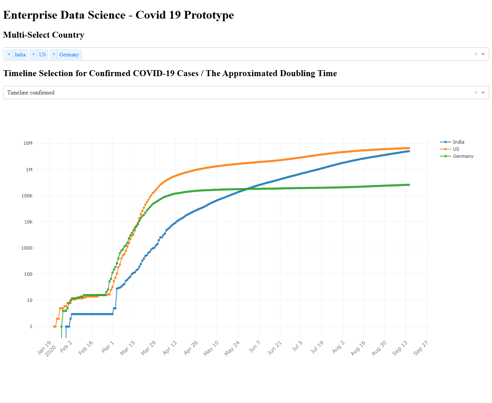
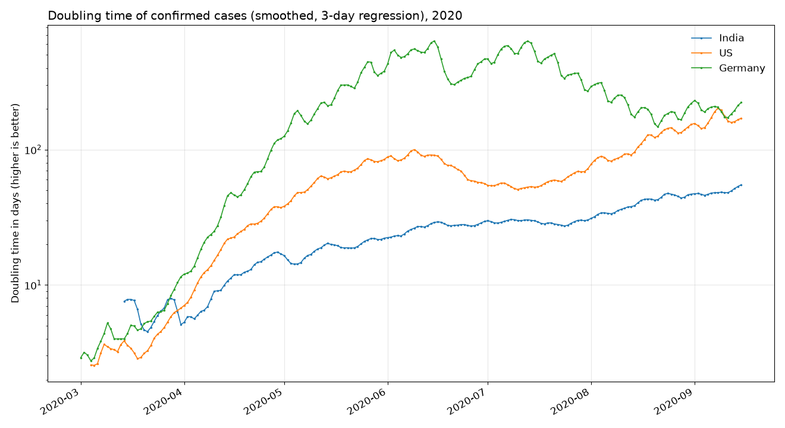

# COVID-19 Data Analysis: Doubling Time and SIR Model

Statistical analysis of the spread of COVID-19 in 2020, built as an applied data science project
following the CRISP-DM process. It turns raw case counts into a clean relational data set, estimates
how fast cases double in each country, fits an SIR epidemic model, and shows the results in two
interactive Plotly Dash dashboards.


## Dashboard

An interactive Plotly Dash dashboard (`src/visualization/visualize.py`): pick one or more countries
and switch between confirmed cases, the raw doubling time and the smoothed doubling time.



Doubling time per country, from the same processed data. A higher value means slower spread:
Germany's cases took over 100 days to double for most of the summer of 2020, while India's
stayed far lower.



A second dashboard (`src/models/SIR_model.py`) fits an SIR model to a country's case curve.

Both images use Johns Hopkins data up to 15 September 2020, the end of the project.

## Data

- **Johns Hopkins CSSE** global time series of confirmed cases
  ([CSSEGISandData/COVID-19](https://github.com/CSSEGISandData/COVID-19), now archived).
- **Robert Koch Institute (RKI)** data for Germany: district-level figures from the RKI ArcGIS REST
  API (`get_current_data_germany`) and a scraped table of cases per German state (`dataminer.csv`).

## Method

1. **Data preparation** (`src/data/process_JH_data.py`): reshapes the wide Johns Hopkins table
   (one column per day) into a relational table with one row per date, state and country.
2. **Smoothing** (`src/data/get_pd_large.py`): a Savitzky-Golay filter (window 5, order 1) smooths
   each country's daily series, since reporting is noisy.
3. **Doubling time**: a linear regression over a rolling 3-day window gives the approximate number
   of days until cases double, on both raw and smoothed data. Values are kept only once a country
   has more than 100 cases.
4. **SIR model** (`src/models/SIR_methods.py`): the susceptible-infected-recovered equations are
   solved with `scipy.integrate.odeint`, and the infection rate β and recovery rate γ are fitted
   to the case curve with `scipy.optimize.curve_fit`.

## Run it

```bash
pip install pandas numpy scipy scikit-learn "dash<3"
git clone https://github.com/CSSEGISandData/COVID-19.git data/raw/COVID-19
cd src/data
python process_JH_data.py                         # relational table
python -c "from get_pd_large import pd_result_large; pd_result_large()"   # filter + doubling time
cd ../visualization && python visualize.py        # dashboard on http://127.0.0.1:8050
cd ../models && python SIR_model.py               # SIR dashboard
```

The code was written in 2020 against pandas 1.x and Dash 1.x; it runs with pandas 1.5 and Dash 2.

## Limitations

- The SIR fit uses a fixed population of 10 million and fits the infected curve to cumulative
  confirmed cases over the whole period. A single SIR curve can't follow a cumulative series
  over several months, so the fit is poor and β and γ are not real epidemiological estimates.
- A 3-day regression window reacts quickly but is sensitive to reporting gaps (for example
  weekends), which is why the smoothed version is shown as well.
- The Johns Hopkins repository stopped updating in March 2023.

## Project layout

```
src/data/            download, relational model, smoothing and doubling time
src/models/          SIR model and its dashboard
src/visualization/   cases and doubling-time dashboard
reports/figures/     CRISP-DM diagram, dashboard screenshot and charts
```

Project structure based on the [Cookiecutter Data Science](https://drivendata.github.io/cookiecutter-data-science/) template.
